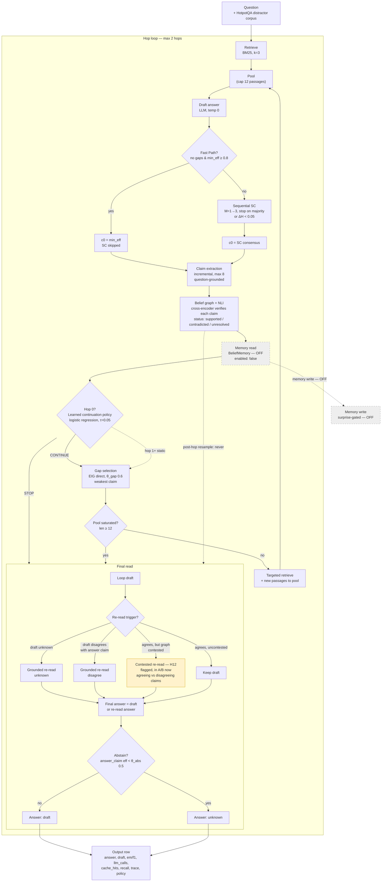

# Adaptive ERag — current system diagram (TrueAdaptive, tuned config, 2026-11-11)

Mermaid flowchart of the tuned system (`configs/erag_trueadaptive_tuned.yaml`)
as it runs today, including the H12 contested-resolution step now in A/B
(Phase 2.5, flagged off by default). Render with any Mermaid renderer
(mermaid.live, GitHub, VS Code preview).



## Notes

- **Flags that change the shape:** `sc_mode: sequential`, `gate_sc_behind_fast_path: true`,
  `claim_strategy: incremental`, `eig_strategy: direct`, `post_hop_resample: never`,
  `saturation_precheck: true`, `ground_final_read: true`, `max_claims: 8`,
  `theta_abs: 0.5`, `theta_fast: 0.8`, `theta_gap: 0.6`, `max_hops: 2` (ceiling),
  `continuation_policy: configs/continuation_policy_dev.json` (τ=0.05).
- **Off / dashed:** memory read and write are implemented and wired but disabled
  (`memory.enabled: false`) — step 6 verdict "instrument too weak" (fired 1/30).
- **Yellow (H12):** contested-claim resolution, behind `erag.contested_resolution`
  (default false), in Dev-100 A/B as of 2026-11-11.
- **Not in this diagram:** the runner/cache (SQLite cache, one fresh namespace per
  run), the retriever (BM25 first, MiniLM as second check), and the baselines
  (Standard / IRCoT / Adaptive-RAG) the system is compared against.
```

