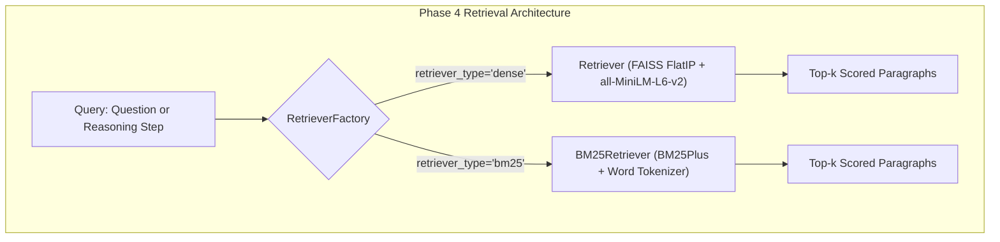

# Design: Phase 4 IRCoT Audit & BM25 Baseline Architecture

## Architectural Overview

This change incorporates sparse lexical retrieval alongside existing dense vector retrieval and codifies the methodological relationship with Trivedi et al. (ACL 2023).

## 1. BM25Retriever Specification

### Formulation
Uses `BM25Plus` from `rank-bm25`:
$$\text{Score}(D, Q) = \sum_{q \in Q} \text{IDF}(q) \cdot \left[ \frac{f(q, D) \cdot (k_1 + 1)}{f(q, D) + k_1 \cdot (1 - b + b \cdot \frac{|D|}{\text{avgdl}})} + \delta \right]$$
where $k_1 = 1.5, b = 0.75, \delta = 1.0$.

Adding $\delta = 1.0$ resolves the known negative-IDF anomaly present in Robertson-Spärck Jones BM25 on small collections (such as 10-paragraph distractor sets), ensuring mathematical parity with Lucene/Elasticsearch non-negative scoring.

### Interface Parity
`BM25Retriever.search(query: str, k: int = 3) -> List[Dict[str, Any]]` returns dicts with `title`, `sentences`, `text`, and `score: float`, perfectly conforming to `Retriever.search`.

## 2. Experimental Control Across Baselines

| Component | Standard RAG | IRCoT-Controlled | E-RAG-Balanced |
| :--- | :--- | :--- | :--- |
| **Model** | `openai/gpt-oss-20b` | `openai/gpt-oss-20b` | `openai/gpt-oss-20b` |
| **Split** | HotpotQA Test-400 | HotpotQA Test-400 | HotpotQA Test-400 |
| **Context Format** | Distractor pool (10 paras) | Distractor pool (10 paras) | Distractor pool (10 paras) |
| **Budget ($P$)** | Top 3 | Cumulative pool cap = 12 | Cumulative pool cap = 12 |
| **Sparse Engine** | `BM25Plus` | `BM25Plus` | `BM25Plus` |
| **Dense Engine** | `all-MiniLM-L6-v2` | `all-MiniLM-L6-v2` | `all-MiniLM-L6-v2` |

## 3. Statistical Validation
- Compare BM25 vs Dense using paired $t$-test / McNemar test on Exact Match.
- Gold paragraph recall comparison across both retrieval backbones.
